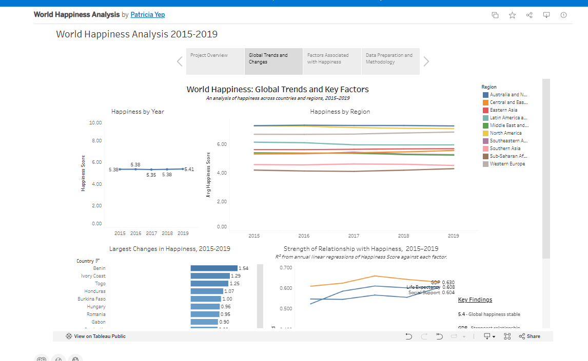

# World Happiness Analysis, 2015–2019

How has happiness changed around the world, and which socioeconomic factors are most closely linked to it?

I cleaned and combined five years of World Happiness Report data in **Excel Power Query** and **SQL Server**, analyzed it in **SQL**, and presented the results as an interactive **Tableau** story.

**[View the interactive Tableau story](https://public.tableau.com/app/profile/patricia.yep/viz/shared/Q5NF5FQZ6)**

[](https://public.tableau.com/app/profile/patricia.yep/viz/shared/Q5NF5FQZ6)

---

## Key findings

- **Global happiness was stable.** The world average stayed between 5.35 and 5.41 out of 10 from 2015 to 2019.
- **Regional gaps are large.** Australia and New Zealand averaged 7.30; Sub-Saharan Africa averaged 4.19.
- **Some countries changed a lot.** Benin rose the most (+1.54); Venezuela fell the most (−2.10).
- **GDP per capita has the strongest link to happiness.** It accounts for 61–66% of the variation in happiness scores each year. Life expectancy and social support follow; generosity accounts for less than 4%.
- **The results hold up.** Limiting the analysis to the 146 countries present in all five years changed no factor by more than 2 percentage points and did not change the ranking.

These are associations, not proof of cause.

---

## Skills demonstrated

| Tool | What I did |
|---|---|
| **Excel / Power Query** | Imported five annual files, standardized column names and data types, reconciled country names, built a Country-to-Region lookup, and combined everything into one clean dataset |
| **SQL (SQL Server)** | Profiled raw data (row counts, duplicates, missing values, value ranges, country coverage); rebuilt the cleaning as a view using `UNION ALL`, `CASE`, `LEFT JOIN` and a lookup table; validated the result; analyzed trends with `GROUP BY`, `HAVING`, conditional aggregation and CTEs; calculated correlation and R-squared from the formula using `CROSS APPLY` |
| **Tableau Public** | Built a four-page story with trend lines, regional comparison, ranked bar chart, scatter plots with a factor selector, and a year-by-year R-squared chart |

---

## Process

1. **Profile** – checked the raw data for duplicates, missing values, unusual values and inconsistent names → [`sql/01_data_profiling.sql`](sql/01_data_profiling.sql)
2. **Clean** – standardized and combined the five years in Power Query, then repeated the cleaning in SQL as a view and validated it (782 rows, 164 countries, 10 regions) → [`sql/02_data_cleaning.sql`](sql/02_data_cleaning.sql)
3. **Analyze** – global, regional and country trends, plus correlation and R-squared for six factors → [`sql/03_data_analysis.sql`](sql/03_data_analysis.sql)
4. **Visualize** – Tableau story (link above)

### Data decisions
- **One missing value** (United Arab Emirates, 2018, Trust) was kept as missing rather than set to zero, and excluded from the correlation calculations.
- **Five countries** were spelled differently across years (e.g. *Hong Kong S.A.R., China* vs *Hong Kong*) and were standardized.
- **Region** existed only in 2015–2016, so it was added to 2017–2019 from a lookup table.
- **Country comparisons** use only the 146 countries present in all five years.

---

## Files

```
excel/
  WorldHappiness_Clean.xlsx     Cleaned, combined dataset (Power Query output)
  Country_Region_Lookup.xlsx    Country-to-Region lookup (Power Query)
sql/
  01_data_profiling.sql
  02_data_cleaning.sql
  03_data_analysis.sql
images/                         Dashboard preview image
```

**Data source:** [World Happiness Report, Kaggle](https://www.kaggle.com/datasets/unsdsn/world-happiness)

